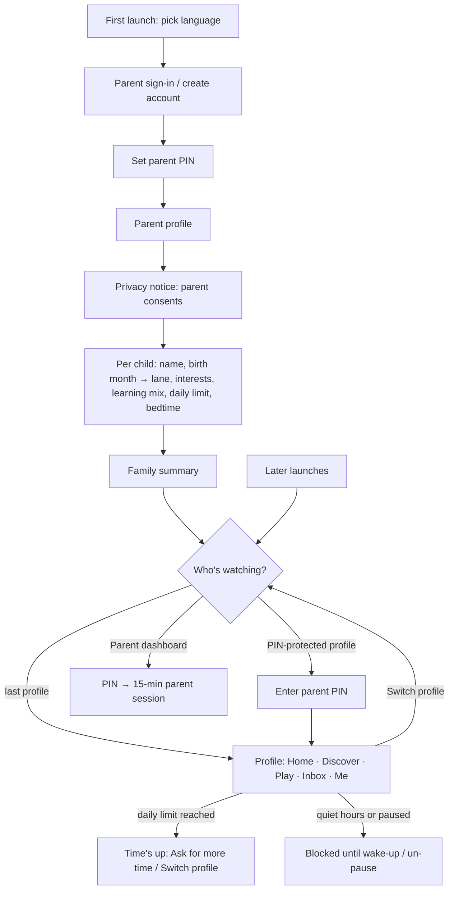
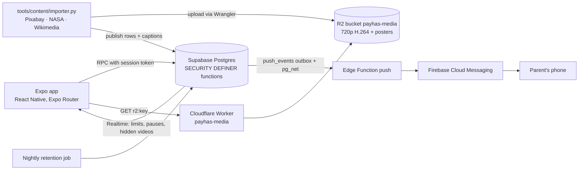

# Payhas — Product Documentation

Last updated Oct 29, 2026 · Onki Games

This is the living product document. Tasks are ticked here as they ship; each
ticked item names the commit or migration that did it.

## Overview

Payhas is a short-video app for the whole family. Every family member gets a full-screen vertical feed, but what each profile can see is decided by its **age lane** on the server, and the parent can see and steer it remotely.

- **Problem:** families share phones, but mainstream short-video apps hand children an open, adult-tuned feed, and none serve Turkmen speakers.
- **Primary user:** the parent who sets up the account, holds the parent PIN and decides what each child may watch, when and for how long.
- **Market:** Turkmenistan first. Turkmen leads; Russian, Turkish and English follow.
- **Platforms:** Android and iOS with one design; release builds run on a Xiaomi phone and an iPhone 12.
- **Success:** a parent can hand over the phone without supervising each swipe, and children still want to open the app.

**What a neighbouring app can't claim:**

1. Lane rules are enforced in the database, not by a client-side toggle. A Little profile can never receive a video above its lane.
2. One household account with live remote control: the parent pauses, adds time, sets bedtime or hides a video, and it lands on the child's device in real time.
3. Turkmen-first content and interface.

## Users and age lanes

One family account per household. The parent owns it; every family member gets a **profile**, and each profile sits in one of four lanes. The lane is set from the birth month entered during onboarding and decides what the profile can see and do.

| Lane | Ages | Colour | What it gets |
| --- | --- | --- | --- |
| Little | 0–6 | Little Sun #FFD25E | Only content cleared for the youngest; screens work through icons, colour and motion for children who can't read yet |
| Kids | 7–12 | Kids Mint #4FE3B0 | Kids-cleared content, games tuned to target rounds |
| Teen | 13–17 | Teen Sky #78A6FF | Teen-cleared content, timed games |
| Adult | 18+ | Adult Lilac #C3A2FF | Everything published; usually PIN-protected so children can't enter |

**The parent** is the primary user. They create the account, set the 4-digit parent PIN, agree to the privacy notice, add children, and use the parent dashboard. The PIN opens a 15-minute parent session.

**Children** watch, play and browse inside their lane and their parent's limits: a daily limit, quiet hours (bedtime to wake-up) and whether games are on. Me tells each child, in words for their lane, what their parent can see.

## UX flow

First launch runs language, parent sign-in, PIN and onboarding once; after that the app always opens on *Who's watching?* (or reopens the last profile).

PIN-protected profiles ask for the PIN to enter. Signing out of a child profile goes through the parent dashboard and the PIN; an Adult profile signs out directly.

## Features

Inside a profile there are five tabs; outside it, the parent dashboard.

| Area | What it does |
| --- | --- |
| Home | Full-screen vertical feed. Swipe left/right between Following and For you; swipe up for the next clip, which is already preloading. Tap to pause or unmute. Right rail: like, save, share. Caption collapsed until tapped, which reveals credit and source. Reactions row under the caption. |
| Discover | Search, then three tabs. **Channels** (default): the busiest channel as a featured card with its three newest posters and Follow, then every channel as a tinted tile with a follow toggle. **For you**: featured shelf and Top 10 in your lane. **Topics**: hand-drawn topic stickers. |
| Channel page | A channel's avatar, clip count, main topics, Follow, and a grid of every clip your lane may watch; tapping one plays it in the feed. |
| Play | Ten lane-tuned games in three sections. Quick play: Bubble Pop, Pop-up Pals, Star Catcher, Echo Lights. Brain games: Memory Match, Odd One Out, Quick Count, Maze Run. Puzzles: Slide Puzzle, Three in a Row. Little never fails or loses; older lanes get clocks, bigger boards and smarter opponents. Best scores stay on the device. |
| Inbox | Welcome notes, new videos picked for you, and family notices such as "your parent gave you 15 more minutes". |
| Me | Avatar with today's watch-time ring, lane, stats, Saved and Taste tabs, "What your parent can see", settings (sound, vibration, language), Switch profile, Sign out. |
| Parent dashboard | Per child: live status (watching, playing, last seen), today vs limit, 7-day chart, top topics, recent videos, anything flagged. Remote controls: pause now, +15 min, daily limit, bedtime and wake time, games on/off, hide a video. Delete one child's profile, or the whole family account. |

**Limits and quiet hours.** A daily limit and quiet hours block both videos and games; game time counts toward the limit. When a limit is reached a Time's up screen offers *Ask for more time* (alerts the parent) or *Switch profile*.

**Feed ranking (For You v1).** Each profile's taste per topic is learned from what it does over the last 30 days (or since *Reset taste*): finishes, rewatches, reactions, likes, saves and shares pull a topic up; quick skips and *Not for me* push it down, and recent signals count more. The interests picked at onboarding lead for a new profile and fade as signals build up. On top: clip quality in the profile's lane (finished often, rarely skipped; anonymous counts, refreshed hourly), learning mix, follows, freshness, seen clips pushed down and a daily shuffle. Every 5th slot is a topic the profile hasn't tried, and no two clips in a row share a channel or lead topic. `why_this()` gives the main reason for any clip (following, picked, liked, explore, new, popular). Always inside the lane.

**Parent alerts.** A parent's phone can opt in to push alerts (for example, a child asking for more time). Children never get notifications. Alert text says only what happened, in the family's language — no child's name or video caption, because it travels through Google and Apple and shows on the lock screen; the dashboard shows who after the PIN. Android uses Firebase Cloud Messaging; iOS builds carry the push capability (Batyr's paid team) but still need an APNs key to deliver (open).

**Languages.** Turkmen, Russian, Turkish and English. The family picks one and the whole app switches, including video captions (every imported clip is captioned in all four). Russian loads a Cyrillic font (Onest) at launch.

## Safety, privacy and content

Safety lives on the server; the app only reflects it.

- **Lane gating in the database.** Row-level security is closed; every read goes through SECURITY DEFINER functions that check the profile's session token and lane. Nothing a child taps can return a video above their lane — the feeds, Discover's channels and a channel's page all use the same gate.
- **Limits enforced server-side.** Daily limits, quiet hours, pauses and hidden videos are stored and checked in the database and pushed to the device over Realtime. Time in all ten games counts toward the limit.
- **Parental consent.** A parent agrees to the privacy notice (from a PIN session, on a confirmed email) before the family's first child profile; the database refuses any new child profile until that consent exists, and records the policy version, language and time. Withdrawing consent means deleting the account.
- **Deletion.** With the PIN, a parent can delete one child's profile or the whole family account from the app (App Store 5.1.1(v), Google Play). Account deletion cascades through every child's history, likes, saves, reports, sessions, inbox and alerts.
- **Retention.** A nightly job deletes watch time, video events and inbox notices after 90 days, alert records and time requests after 30 days, reviewed reports after 180 days, and expired sessions. What a family chose to keep (likes, saves, follows, limits) stays until deletion.
- **Device permissions.** Android blocks the advertising ID, location, camera and microphone permissions.
- **Curated content only (today).** An automated importer (`tools/content/importer.py`) pulls from three licensed sources: **Pixabay** (Pixabay Content License), **NASA** (NASA-made footage only, public domain) and **Wikimedia Commons** (CC0, public domain, CC BY, CC BY-SA only). Each batch is searched, reviewed on contact sheets, checked frame by frame, captioned with one true fact in four languages, given a lane and topics, encoded at 720p and published with its source and licence credit. 229 clips are live (209 Pixabay, 16 Wikimedia, 4 seed or test); the NASA batch and the rest of the Wikimedia batch are in progress.
- **Review queue.** Built but switched off for now (`review_required = false`); content is gated by lane only.

**Hard constraints — never break these:**

- No microphone or camera permissions; this is a children's app.
- No AI-generated content, no identifiable children, no logos or burned-in text, no gore or predation in imported content. No clips ripped from TikTok, YouTube or other platforms.
- Every clip carries its source and licence credit.
- Secrets (service keys, Firebase files) never enter the repository.

## Payhas Plus (business model)

One monthly plan per family: **20 TMT a month**. No trial; a free tier stays free.

| | Free | Plus |
| --- | --- | --- |
| Profiles (adults included) | 2 | 3 |
| Games | Quick play: Bubble Pop, Pop-up Pals, Star Catcher, Echo Lights | All 10 |
| Videos | 30 a day per profile | No daily cap (the parent's limits still apply) |
| Parent dashboard | Today | 7-day chart, top topics, recent videos |

- **Safety is never paid.** Daily limits, quiet hours, pause, hiding videos and flagged videos work the same on Free.
- **Children never see a price.** The Plus page sits behind the parent PIN; a locked game or the end of today's videos tells the child to ask a parent or come back tomorrow.
- **Limits live on the server.** Profile limit (a trigger on `profiles`), the 30-video cap (the feed functions return nothing past it) and the trimmed dashboard are enforced in the database; the app only reflects them.
- **Paying:** activation codes now — `PAYH-XXXX-XXXX-XXXX`, sold through shops, banks or operators, entered on the Plus page. Codes are stored hashed, work once, stack (each adds its months after the current end) and lock out after 5 wrong tries an hour. Admins create a batch in the SQL editor with `select * from private.create_plus_codes(100, 1, 'batch-name');`. Local card payment comes later as another source.
- Families with more profiles than their plan allows keep them; the limit only stops new ones.

## Design system

The system is **"The Night-Light Playroom"**: a dark, calm room lit only by one warm ember for "do this" and four lane colours for "who and how old". Chrome is quiet at rest and comes alive under touch. The full spec lives in `DESIGN.md`; screen patterns from the Mobbin references are in `DESIGN_V2.md`.

| Element | Spec |
| --- | --- |
| Ground and surfaces | Ink #0A0A0F, Night Surface #14141B, Raised Surface #1D1D26, Hairline #2A2A35. No light theme. |
| Action colour | Ember #FF5A3C, one call to action per screen, always ink text on it |
| Lane colours | Little #FFD25E, Kids #4FE3B0, Teen #78A6FF, Adult #C3A2FF — identity only, never decoration |
| Status colours | Success, warning, danger, info, reward tokens; kept to parent, creator and system surfaces |
| Type | Bricolage Grotesque for headings (tight tracking), Figtree for UI, JetBrains Mono for numbers; Onest for Cyrillic |
| Shape | Chips 12–16, cards 20, video 28, buttons and tab bar as pills |
| Depth | Tonal layering; a hard "ledge" under tactile controls; real shadows only on the floating tab bar and toasts |
| Motion | Spring presets (snappy, smooth, bouncy), 45 ms stagger, respects reduce-motion |
| Icons | Hand-drawn: topic stickers (ink outline, colour fill, white glint), nav icons with their own moves, a UI glyph set in the same family |
| Touch | Targets at least 48 dp; text-bearing controls grow with the system font size |

## Technical architecture

The app holds no rules of its own: every read and write is a call to a Postgres function that checks the profile's session token and lane.

- **Video hosting:** the curated library lives in the Cloudflare R2 bucket `payhas-media` (720p H.264, posters alongside). The database stores `r2:<key>` paths; the app turns them into URLs on the media Worker (`workers/media`, `https://payhas-media.guvanch-site.workers.dev`), which serves GET/HEAD with range requests and year-long immutable caching. `EXPO_PUBLIC_MEDIA_URL` overrides the address. Creator uploads stay private in Supabase Storage with signed links. The first 1 GB moved from Supabase to R2 on 28 Oct, every file verified by size.
- **Playback:** the next clip preloads on a small buffer; library video is cached on disk.
- **Builds:** Android release APKs are built locally with Gradle; the iOS project is generated by Expo prebuild with CocoaPods and signed with Batyr's paid Apple team (`M4V4D8KSX3`), push capability included. Native folders are generated, not committed.
- **CI:** GitHub Actions runs typecheck and lint on every push (`.github/workflows/ci.yml`).
- **Database changes** ship as SQL migration files in `supabase/migrations/`, applied in the Supabase SQL editor.
- **Secrets** (service key, Pixabay key, Firebase files) stay in the gitignored `.env` and the Supabase secret store; R2 uploads use Cloudflare's own login (Wrangler), so no storage keys sit on disk.

## Status and tasks

The core app is built and running on Android and iPhone; content is growing through the automated importer.

### Done

- [x] Feed with Following/For you swipe
- [x] Discover with channel hubs and channel pages
- [x] Play with ten lane-tuned games
- [x] Inbox and Me
- [x] Accounts and age lanes with parent PIN
- [x] Onboarding with real data
- [x] Four languages, with a Cyrillic font for Russian
- [x] Parent dashboard with remote control
- [x] Parent alerts on Android (code)
- [x] Multi-source content importer (Pixabay, NASA, Wikimedia) publishing at 720p to Cloudflare R2
- [x] iOS builds on a paid team
- [x] UI v2 with hand-drawn icons and nav motion
- [x] Accessibility pass (48 dp targets, font scaling, screen-reader announcements)
- [x] Crash fix for iOS release builds

### Privacy and launch readiness

- [x] Delete the whole family account from the app — `74ef762`, `20261029120000_delete_account.sql`
- [x] Nightly retention purge; no child's name or caption in parent alerts, phone name not kept — `594e14b`, `20261029130000_retention.sql`, `20261029140000_push_privacy.sql`
- [x] Tell children what their parent can see, in their lane's words — `6effef2`
- [x] Delete one child's profile from the dashboard — `34b71d7`
- [x] Parental consent before the family's first child profile — `00e8468`, `20261029150000_parental_consent.sql`
- [x] Block advertising ID, location, camera and microphone on Android — `d85d894`
- [x] Migration backlog applied to the live database (Oct 29, verified): `push_notifications`, `more_games`, `delete_account`, `retention` (nightly purge scheduled), `push_privacy`
- [ ] Apply `20261029150000_parental_consent.sql` — held until test phones run a build with the consent screen (the database then refuses new child profiles without consent)
- [ ] Turn on leaked password protection (Supabase → Authentication → Providers → Email)
- [ ] Remaining privacy review items — deferred for now (the review isn't in the repo; add its list here when it's picked up)
- [ ] Store kids-category requirements (App Store Kids, Google Play Families)
- [ ] Crash reporting and analytics that fit a children's app
- [ ] TestFlight / Play internal beta, then store submission

### Roadmap

- [x] Preload the next clip — `4984c74`
- [x] Lint and CI — `3116545`
- [x] Double-tap to like, with burst animation
- [ ] Share sheet
- [ ] Long-press "Why this?" / "Not for me"
- [x] Watch-event logging (impression, finish, rewatch, quick skip, share, Not for me, seconds watched)
- [x] For You v1: ranking learns from logged signals, lane quality, exploration slot, variety, `why_this()` — `20261029153000_for_you_v1.sql`
- [x] `20261029153000_for_you_v1.sql` applied to the live database (Oct 29; hourly quality refresh scheduled with pg_cron)
- [ ] Show "Why this?" chips and taste dials in the app (server side ready: `why_this()`, `private.topic_affinity`)
- [ ] For You v2: embeddings with pgvector (once the library reaches about 1,000 clips)
- [ ] Native-speaker review of the Turkmen copy

### Open decisions and setup

- [x] Serve R2 without r2.dev (rate-limited, not for production) — media Worker, `8e6400d`
- [ ] Delete the old video copies in Supabase Storage (about 1 GB) now that the library plays from R2
- [ ] APNs key for parent alerts on iPhone
- [ ] Firebase setup for Android alerts (`google-services.json` and service-account secret)
- [ ] YouTube embeds for creator videos (needs a Google Cloud API key)
- [ ] Creator uploads and the safety classifier pipeline (not built; content is curated only)
- [x] Business model: Payhas Plus, 20 TMT a month per family, 3 profiles; free tier with 2 profiles, 4 games, 30 videos a day, today-only dashboard
- [x] Plus: database plans, hashed activation codes, server-side limits — `20261029160000_plus.sql`
- [x] Plus: Payhas Plus page behind the PIN, Plus card and locked history in the dashboard, profile limit in Add and onboarding
- [x] Plus: locked games and the end-of-day card for children (no prices)
- [ ] Apply `20261029160000_plus.sql` to the live database (with the app build that shows the new screens)
- [ ] Local card payment (choose a bank and its online payment API)
- [ ] Decide where activation codes are sold, and print the first batch
- [ ] Tablet layouts (iPad support is off until then)
